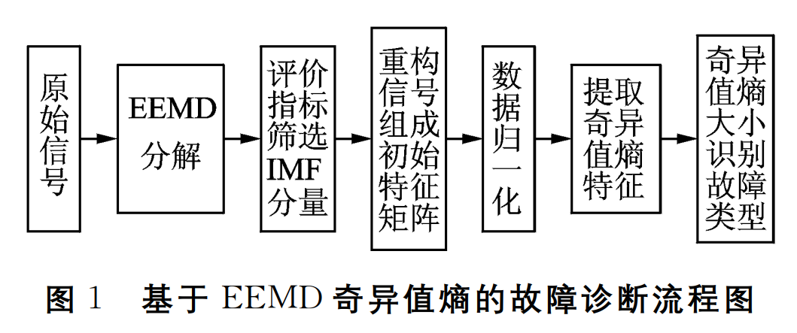
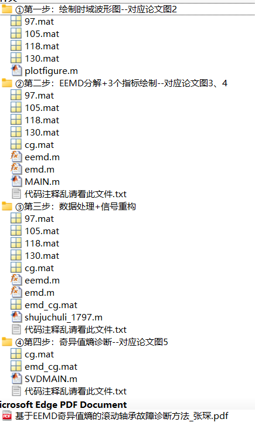
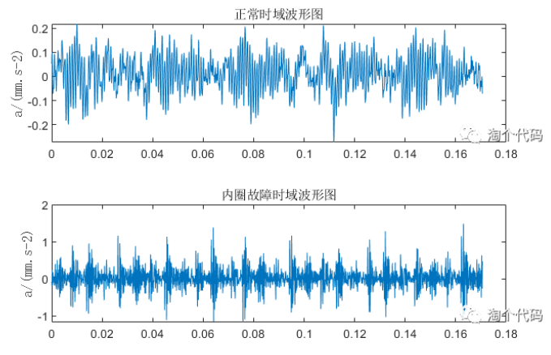
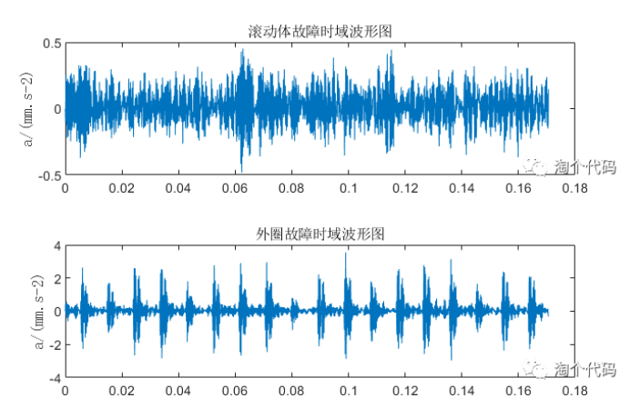
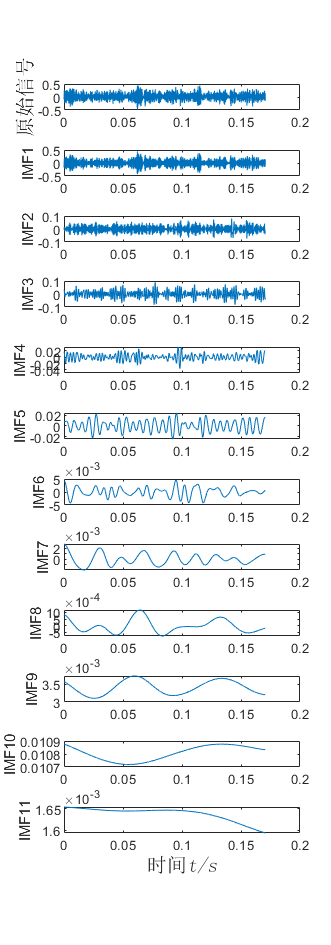
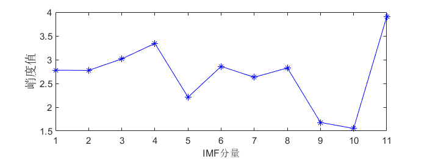
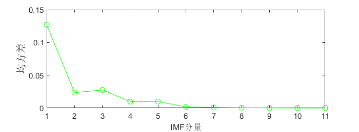
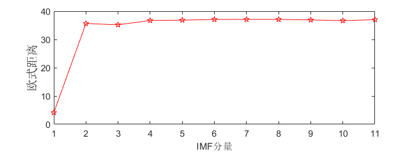
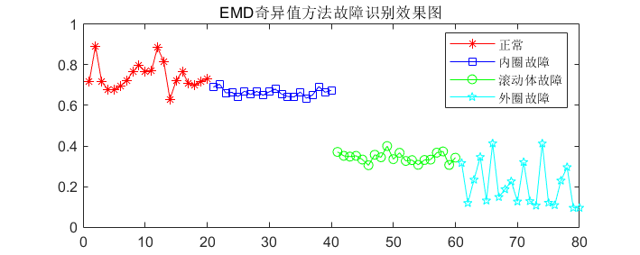
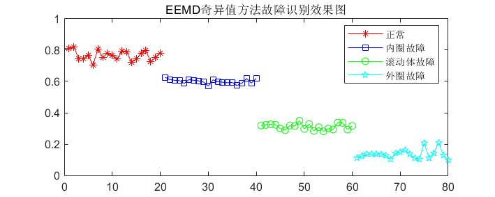

# Fault Diagnosis, Rolling Bear Fault Diagnosis Method Based on EEMD Singular Value Entropy, MATLAB Code Implementation

The article's conception comes from a three-high paper published in the Journal of Vibration Testing and Diagnosis. Click the link to access it. The recommended "three-high" paper is based on the singular value entropy method for rolling bearing fault diagnosis, which has been cited 58 times in CNKI.

\n        \n      Summary of the article is as follows:
To fully utilize vibration signals for fault identification, this paper proposes a method for rolling bearing fault diagnosis based on ensemble empirical mode decomposition (EEMD) singular value entropy criterion. Firstly, the vibration signal of the rolling bearing is decomposed using EEMD to obtain several intrinsic mode functions (IMF), and then selects the component that represents the fault information content of the original signal according to an evaluation index of IMF component fault information content (i.e., kurtosis, mean square deviation, and Euclidean distance). This selected component is used for signal reconstruction; secondly, the reconstructed signal is processed using singular value decomposition technology, and the singular value entropy is calculated by combining the information entropy algorithm; finally, the size of the singular value entropy is used to determine the type of fault in the rolling bearing. The results of verifying the method with the vibration signal of the rolling bearing from the University of Western Colorado show that compared to the traditional EMD singular value entropy fault diagnosis method, this method can clearly divide the category characteristics interval of different working states of the rolling bearing, and has higher fault diagnosis accuracy.

The process is as follows:
This issue will use MATLAB code to strictly reproduce all simulation results mentioned in the paper! The main method of this paper will be perfectly reproduced! Let's first look at the code directory: All codes are .m files, not those encrypted .p files!

Next, let's explain each step in the screenshot above:
First step: drawing time domain waveform graph--corresponding to Figure 2 in the paper.
The data used in the paper are four states of bearing faults at 1797 rotation speeds from the Xichu University bearing fault dataset, namely normal, inner ring fault, rolling element fault, outer ring fault. They correspond to 97, 105, 118 and 130.mat respectively.
Firstly, draw the time-domain waveforms of each state. The following figure is obtained by running the first step's plotfigure.m file:
\n     \n      \n        \n      Step 2: EMD decomposition + 3 indicators plotting - corresponding to Figures 3 and 4 in the paper.
Here, the article takes the example of rolling element failure 118.mat for explanation. EEMD decomposition diagram:
\n        \n      A method for evaluating the authenticity of IMF components based on kurtosis, mean squared error and Euclidean distance is proposed to select real IMF components that reflect fault information.
IMF component histogram:
\n        \n  
IMF component variance plot:
\n        \n  
IMF component Euclidean distance plot:
\n        \n  
The three evaluation indicators of the IMF components decomposed by EMD for the rolling element fault signal are shown in the above three graphs. From the graphs, it can be observed that the first three IMF components have a higher kurtosis and mean square deviation than the other components; the Euclidean distance between each IMF component and the original signal starts to level off starting from the third IMF component. Based on the properties of the three evaluation methods, the first three IMF components contain rich fault information and can characterize the operational state of the rolling bearing, providing assurance for the subsequent extraction of initial feature matrix singular value entropy. Therefore, the first three IMF components are selected for signal reconstruction and subsequent singular value entropy calculation.
Step 3: Data Processing + Signal Reconstruction
The second step has already indicated that the first three IMF components can be used to characterize the bearing status. The paper mentions using 20 sets of data for each state, but it does not specify how many sample points are used in each set.
As before, Xiao Tao has selected 2048 sampling points for each state.
There are a total of 4 states, with each state comprising 20 sets of samples. Each sample has a data volume size of 1×2048. Subsequently, the EEEMD decomposition is performed on each set of 20*4*2048 data.
Since the article will be compared with EMD decomposition later, third step here also involves EMD decomposition.
Running the file shujuchuli_1797.m will yield two files, cg.mat and emd_cg.mat. cg.mat contains the data obtained from the EEMD decomposition, while emd_cg.mat contains the data derived from the EMD decomposition.
Step 4: Singular Value Entropy Diagnosis - Corresponding Figure 5 in the Paper
Copy the cg.mat and emd_cg.mat obtained from step three into the fourth step. Running SVDMAIN.m can directly perform singular value decomposition on all state samples of both data sets, and calculate singular value entropy and plot it. The results are as follows:
\n        \n  
From the figure, it is evident that due to the inherent limitations of EMD decomposition, the singular values entropy obtained from different signals after decomposition has a small difference, leading to a fuzzy range for the singular value entropy of four states of rolling bearings, making it difficult to distinguish between fault categories. However, in the decomposition of EEMD, it can be observed that there are significant differences in singular value entropy among different fault categories of the rolling bearings. Compared with the traditional EMD singular value entropy method, the EEMD singular value method can more clearly distinguish between fault categories.
The four states of rolling bearings belong to different ranges, and there is no intersection between the categories. This result indicates that the criterion of EEMD singular value entropy can accurately distinguish the fault types of rolling bearings.
Attention! Students who can read this carefully, you might also consider replacing the EMD method in this article with another data decomposition method. Alternatively, you could replace the singular value entropy in this paper with the entropy of another decomposition method. This might be a good way to write a watered-down paper!
Some code shared.
clc

## Images

<!-- PAYMENT_BLOCK -->

## Get this dataset

- Payment link (Stripe): [Buy now](https://buy.stripe.com/3cs8yP7sY87d0vu9AB)
- Payment QR code: 

<!-- /PAYMENT_BLOCK -->
